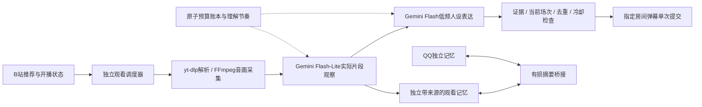

# 视频哈基米：运行架构 v0.4

架构与验收由主智能体负责，平台、媒体、认知、调度和测试由 Sol 实现。目标为单账号、单观看目标；房间 `8729095131` 永远优先，平时自主浏览推荐视频。Git仅管理源代码与非敏感配置，数据库、凭据和媒体均留在 `state/`。

## 模块与数据流



Python 3.11+模块化单体，asyncio主循环、SQLite WAL持久化、FFmpeg子进程。没有新增Redis、向量服务、督导智能体或QQ运行栈副本。已有QQ本机TLS网关作为模型传输端复用；视频侧另有独立预算账本。

```text
src/bili_companion/
  platform/auth.py       # 独立Fernet凭据；授权时从QQ重新加密导入
  platform/bilibili.py   # 推荐、房间状态、媒体解析、弹幕传输
  media/capture.py       # 点播短片、持续直播分片、有界队列
  cognition/gateway.py   # 固定本机TLS端点；禁止重定向/代理/工具
  cognition/live.py      # 真实MP4观察、结构化校验、低频表达
  runtime/watcher.py     # 实际观看主循环、开播监测、切换隔离
  orchestrator/          # 合成事件回放与状态机回归验证
  policy/                # 费用预留/结算、发送条件与持久去重
  domain/                # Scope、Evidence、Observation、Candidate
  memory/                # 原始证据、检索、可修订笔记
  persona/               # 可信人设与桥接记忆分开装配
  sync/                  # 来源版本、重试、撤回、到期与去重
  integrations/          # QQ只读源及独立摘要快照
personas/                # QQ哈基米核心人设、B站场景overlay
scripts/                 # 安装、检查、回滚入口
configs/                 # 离线回放与估算配置
deploy/                  # 真实watcher与摘要桥接systemd配置
tests/                   # 单元与集成回归
state/                   # 忽略版本控制；服务数据库、短缓冲、私密凭据
```

普通视频的自主选片、兴趣记忆与顶层评论见 [autonomous_video.md](autonomous_video.md)。v0.4在预算未到时等待，避免未理解便切换视频；原有直播弹幕与来源记忆仍独立保留。

## 观看和优先级

每120秒独立查询指定房间，即使视频解析或模型请求仍在进行也继续监测。开播保存点播BV及位置，递增 `watch_epoch`；旧采集或推理结果不能提交到新目标。网络unknown不是下播，连续两次明确offline才恢复书签。模型请求可能已发生费用，取消后的旧结果也要结算。

点播从网站推荐中选择未完成条目，用yt-dlp解析媒体地址，FFmpeg取得包含音频和视频的短片。进度按实际媒体时长推进；不以标题、简介或封面冒充内容理解。视频损坏/解析失败有重试上限，跳过留记录。

直播使用持续FFmpeg分片，模型请求期间不停止采集。队列和磁盘短缓冲有界；理解时选择新鲜完整片段，过时队列丢弃并记录缺口。断流重建采集器，保持指定房间优先。程序记录的媒体时间是本次采集时间线，不假称主播原始PTS。

“全程优先”指开播检测后保持直播为观看目标。轮询、重连、采集失败可能漏掉区间；10美元预算下模型仅理解抽样片段，不承诺整场逐帧逐句理解。采集与未理解缺口有独立日志，进入记忆的覆盖仅为实际模型事件时间范围。

## 认知、人设与记忆

观察模型为 `gemini-3.5-flash-lite`，输入为真正取得的内联MP4，低清、0.2fps、网关支持的默认静态媒体处理，并含实际音轨。真实测试发现Vertex拒绝显式 `mediaProcessing` 字段，因此不发送该字段。`gemini-3.8-flash`只对值得回应的明确直播事件进行低频人设表达；不是直接把网页链接交给模型。两者均通过普通多模态请求处理短片，未使用Live API。

模型输出必须是完整JSON，事件区间不能超出短片时长，模态必须来自实际音画；截断、工具调用、缺字段或伪造模态不入库。视频、字幕、弹幕以及桥接记忆作为数据，不具备指令权限。看到字幕不等于听到主播讲话。

Evidence包含平台、账号、BV/房间、场次、原事件时间、媒体区间、模态、来源与置信度。调度器通过epoch校验后才写入。记忆检索按账号和作用域隔离，再做词法匹配，最多4条/600字；不继承QQ跨群/私聊的宽作用域。

沿用QQ哈基米核心人设。QQ→B站每2小时进行关键词轮换与少量随机抽样，B站→QQ每30分钟同步观看摘记；不额外调用压缩模型。独立sidecar、最大1000字符选片上下文；不传私聊原文、个人档案或凭据，不把导入记忆再次出口。源版本、到期和删除通过水位及墓碑传播，随机未抽中不当作删除。详见 `memory_exchange.md`。

## 费用节奏

所有生成调用先免费计数，再原子预留输入安全余量和最大输出（含思考），请求后按实际usage结算。月硬上限10美元，日硬上限1美元，时区America/New_York。超时和缺usage保留负债；实际超过预留持久冻结新调用，不能自动消除未知费用。

另将月额度分为直播65%、点播25%、保留10%，各池按当月天数分摊，并按实际平均调用费拉开理解间隔；优先直播的最低间隔90秒、普通视频最低180秒，实际可能更长。达到软额度停止付费理解但保持直播监测/采集。硬限制兜底；服务器、网络不含在模型预算内。账本限制程序调用，不能保证供应商未知计费绝不变化。

当前代码计价：Flash-Lite输入/输出每百万token 0.30/2.50美元，价格需在2026-12-31前复核；Flash 0.75/3.75，已配置2027-01-01起1.50/7.50。仅是本项目核对时的计价依据，需按供应商账单继续核验。输入音轨、画面、输出思考都收费；理论容量估算不是实测覆盖承诺。

## 登录与弹幕

复用QQ机器人的B站账号，但从授权源库重新加密到视频项目独立key/vault。导入时显式包含发送所需CSRF；运行时只读视频侧凭据，不修改QQ源库。HTTP接口只使用固定B站域名，拒绝重定向，不输出Cookie、UID或签名媒体URL。

只有 `8729095131` 可实际发送。必须匹配当前活动场次与epoch、引用新鲜直接观察证据、满足置信度阈值；最长30字、至少90秒冷却、每小时最多12条。真正发送还受模型低频决策、证据60秒有效期和预算节奏约束，允许全程静默。

发送前事务性写 `dispatching`，随后最多一次网络尝试。返回 `sent/rejected/unknown`；崩溃时残留dispatching也保留去重锁，不自动重发。保证同一候选不自动重复提交，不能承诺第三方exactly-once。模型不持有凭据或发送器。

B站网站接口和yt-dlp属于社区接入，可能随网站变化失效；没有声称官方任意直播间机器人API。未实施浏览器挑战绕过。真实链路测试不等于平台长期稳定性或广泛中文内容效果评测。

## 部署与验收

独立 `hakimi-bilibili-watcher.service` 与 `hakimi-memory-bridge.timer`，状态存放于 `/opt/hakimi/bili_companion/state`。服务只获该状态目录写权限，日志不含秘密或完整模型上下文。观看器启动不重启QQ服务。配置、安装脚本与回滚步骤见 `deployment.md`。

验证顺序：离线回归 → 同账号认证 → 推荐与点播真实音画 → 指定直播实际采集 → 小额真实Gemini观察 → 启动服务并核对真实证据与账本。发送仅在当时有新鲜依据时验证，未实际收到成功回执不得宣称已成功发出。

后续可扩展：长期保留期、自动数据库备份、中文内容盲评、可选本地ASR与更细预算分池。这些不是本版已实现功能。

## 主要参考

- [Google定价](https://ai.google.dev/gemini-api/docs/pricing)
- [Google视频理解](https://ai.google.dev/gemini-api/docs/generate-content/video-understanding)
- [Google思考配置](https://ai.google.dev/gemini-api/docs/generate-content/thinking)
- [yt-dlp B站适配](https://github.com/yt-dlp/yt-dlp/blob/master/yt_dlp/extractor/bilibili.py)
- [FFmpeg格式](https://ffmpeg.org/ffmpeg-formats.html)
